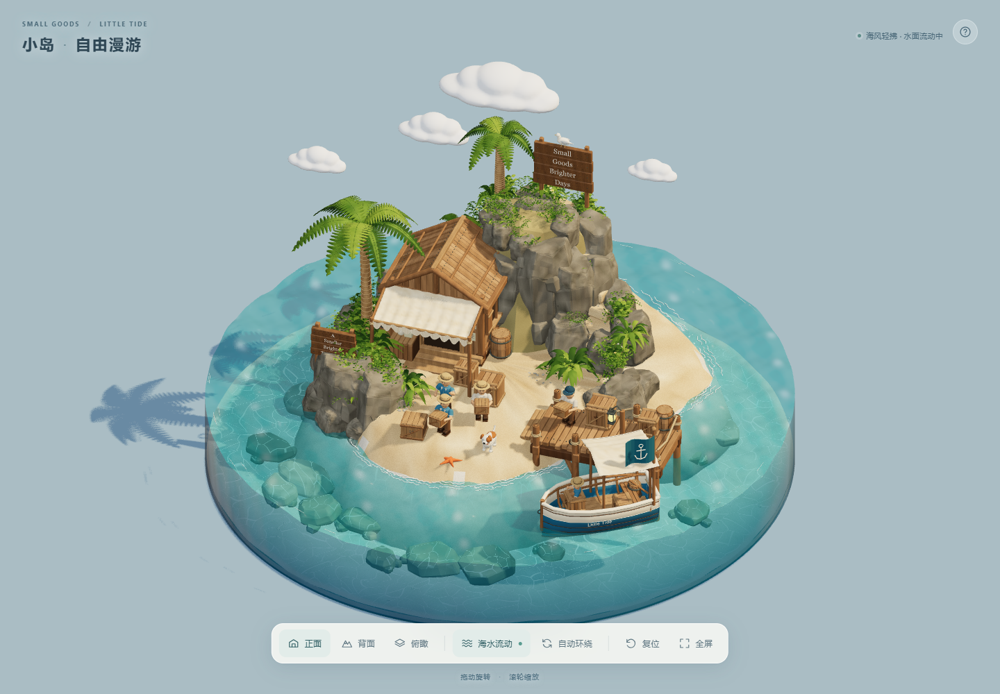
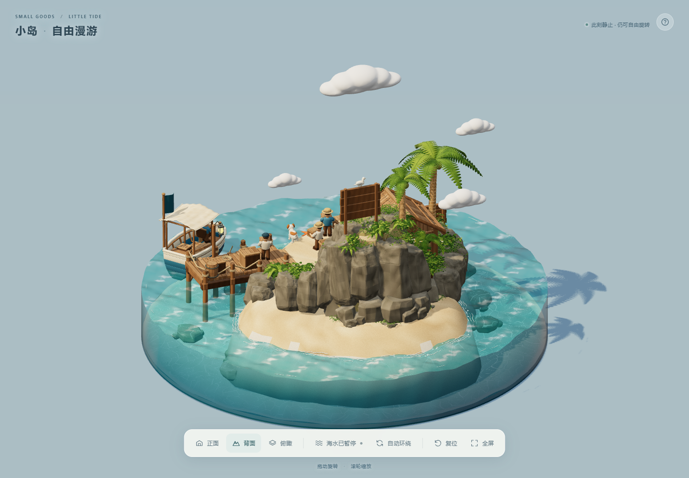
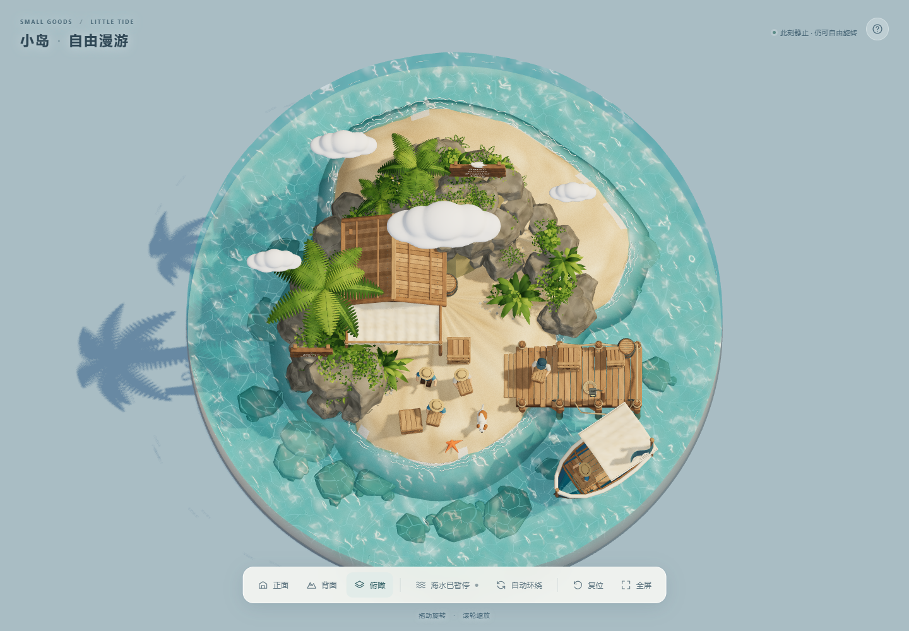
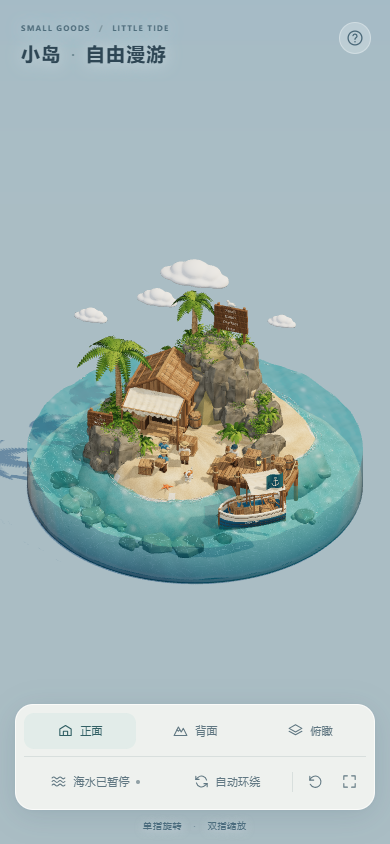

# 小岛 · 自由漫游

一座可以自由旋转的热带小岛：木屋、码头、小船、人物、棕榈树、山坡和四朵云，配合实时海浪、水下光纹与小船轻晃。

**[打开在线展示](https://small-goods-harbor-yfsong.flowymule11.chatgpt.site)** · [下载 Blender 模型包](blender/small-goods-harbor.blend.zip) · [Blender 与 MCP 工作流](docs/blender-workflow.md)

本仓库是独立项目，包含可运行的网页、GLB 模型、可编辑的 Blender 场景包及使用说明。GitHub 仓库保持私有；在线展示页已单独设为公开访问，无需登录。

## 实际画面

以下图片来自本仓库网页的真实浏览器截图，拍摄于 2026-10-22。它们展示网页当前效果；Blender 离线渲染的材质和光照会有所不同。



| 背面 | 俯瞰 |
| --- | --- |
|  |  |

手机尺寸预览：



## 本地运行

网站采用原生 HTML、CSS、JavaScript 和 Three.js，运行依赖已经随仓库提供，**无需安装 npm 依赖，也无需构建**。

1. 通过有权限的 GitHub 账号克隆或下载本私有仓库。
2. 安装 Python 3，在仓库根目录运行以下命令。
3. 在浏览器打开 <http://127.0.0.1:5198/>。

Windows：

```powershell
py -m http.server 5198 --bind 127.0.0.1 --directory dist
```

macOS / Linux：

```bash
python3 -m http.server 5198 --bind 127.0.0.1 --directory dist
```

终端按 `Ctrl+C` 停止。如果端口被占用，将命令和地址中的 `5198` 改为其他空闲端口。请通过 HTTP 服务器访问，不要直接双击 `index.html`。

浏览器需要支持 **WebGL 2、ES Modules / importmap、Web Worker 和 WebAssembly**。网页不需要运行 Blender 或 MCP。默认 GLB 约 5.36 MB，首次打开还会加载本地打包的 JavaScript 和解码器；5.36 MB 并非整页总下载量。

## 操作

| 功能 | 鼠标 / 键盘 | 触屏 |
| --- | --- | --- |
| 旋转 | 左键拖动 | 单指拖动 |
| 缩放 | 滚轮 | 双指开合 |
| 平移 | 右键拖动 | 双指拖动 |
| 暂停 / 继续 | 「海水流动」按钮或空格 | 点击「海水流动」 |
| 回到初始视角 | 「复位」按钮或 `R` | 点击「复位」 |

底部还可选择正面、背面、俯瞰、自动环绕和全屏。暂停会冻结海浪、岸边泡沫、水下光纹和小船，仍可操作相机；已开启的自动环绕也会继续。

## Blender 模型与 MCP

[模型压缩包](blender/small-goods-harbor.blend.zip)提供与当前网页模型导出版本对应的可编辑场景快照。下载并解压后，用 Blender 打开其中的 `.blend` 文件；制作和复核环境为 Blender 5.2。具体保留内容、文件校验和隐私处理见 [模型包说明](blender/README.md)。

MCP 是建模时可选的控制方式，用于让支持 MCP 的客户端与本机 Blender 通信。**查看或编辑 `.blend` 文件本身不依赖 MCP**。连接方式、工作流程、动画预览和网页转换的区别，见 [Blender 与 MCP 工作流](docs/blender-workflow.md)。

本仓库提供网页源代码与可编辑场景快照；不包含原始对话记录、完整历史建模脚本或离线渲染视频，也不保证能从空白场景自动重建全部建模历史。

## 文件结构

```text
.
├── README.md
├── THIRD_PARTY_NOTICES.md       # 第三方依赖来源与许可
├── .openai/hosting.json        # Sites 标识和静态目录配置，不含认证凭据
├── blender/
│   ├── small-goods-harbor.blend.zip
│   └── README.md              # 模型内容、隐私处理和校验信息
├── docs/
│   ├── blender-workflow.md    # Blender / MCP 使用说明
│   ├── verification.md        # 本次运行与交互检查说明
│   └── images/                # README 使用的真实网页截图
└── dist/                      # 公开网站的静态发布目录
    ├── index.html
    ├── style.css
    ├── viewer.js              # 场景加载、相机、光照和交互
    ├── water.js               # 实时水面、侧壁与水下光纹
    ├── public/assets/         # GLB 与模型元数据
    └── vendor/                # Three.js、Draco 和许可证
```

网页可编辑源码直接位于 `dist/`，不是由本仓库中隐藏的 `src/` 构建出来的。部署到其他静态托管服务时，发布 `dist/` 的内容，并保留 `public/assets/` 和 `vendor/` 的相对目录结构。

## 模型与动画实现

| 资源 | 大小（十进制） | 三角面数 | 用途 |
| --- | ---: | ---: | --- |
| `harbor-lite.glb` | 5.36 MB | 588,520 | 默认网页模型 |
| `harbor.glb` | 8.87 MB | 1,129,029 | 高细节备用资源 |

界面没有高低画质切换。当前加载逻辑通常使用精简模型，仅在精简元数据请求返回非成功 HTTP 状态时尝试备用资源；它不是覆盖所有下载或解码错误的自动回退机制。

两个 GLB 都使用 Draco 压缩，解码器已本地打包。模型颜色主要保存在顶点色中，木纹、沙粒与岩石细节由网页着色器补充，不依赖外部图片贴图。GLB 本身没有动画片段；海浪、岸边泡沫、水下光纹和小船运动由 `water.js` / `viewer.js` 实时实现，按六秒周期循环。

网页水体使用透明着色、反射与深度着色近似，并非完整流体模拟或 Blender Cycles 的物理折射复现。因此网页与 Blender 在材质细节、折射、阴影和光照上会有差异。

## 访问与隐私

- GitHub 源码与 Blender 包保存在私有仓库中，只有获授权的账号可以访问。
- 在线展示页是公开的，浏览器必须下载网页代码与 GLB 才能显示 3D 场景，因此这些网页运行资源可被访问者获取。
- Blender 包和 MCP 文档放在 `dist/` 之外，不会随当前静态发布配置上传到公开网站。
- 不应把登录令牌、个人配置、真实账号密码或本机目录写进项目文档或模型属性。MCP 只用于本机连接，连接范围和凭据处理见工作流文档。

## 验证与依赖许可

已从 GitHub 克隆副本运行静态服务器，检查模型加载、动画、暂停、旋转、缩放、相机预设和手机尺寸布局；详情见 [验证说明](docs/verification.md)。这不代表已覆盖所有手机硬件或浏览器。

Three.js 和 Draco 的完整许可证随源码提供，来源见 [THIRD_PARTY_NOTICES.md](THIRD_PARTY_NOTICES.md)。这些第三方许可不自动授予本项目场景和原创应用代码额外的开源使用权。