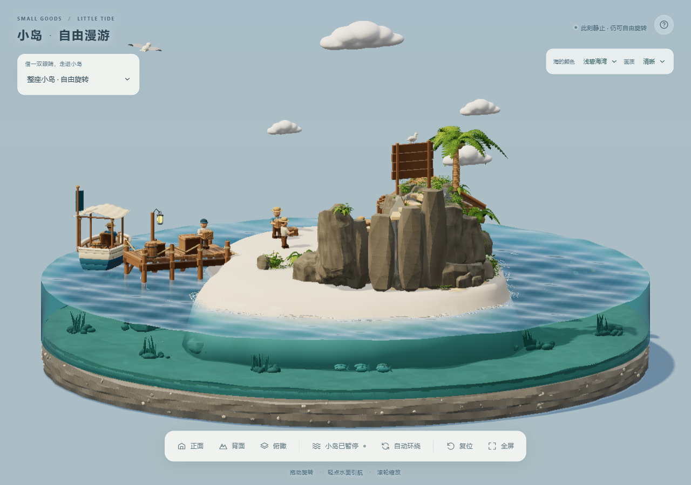
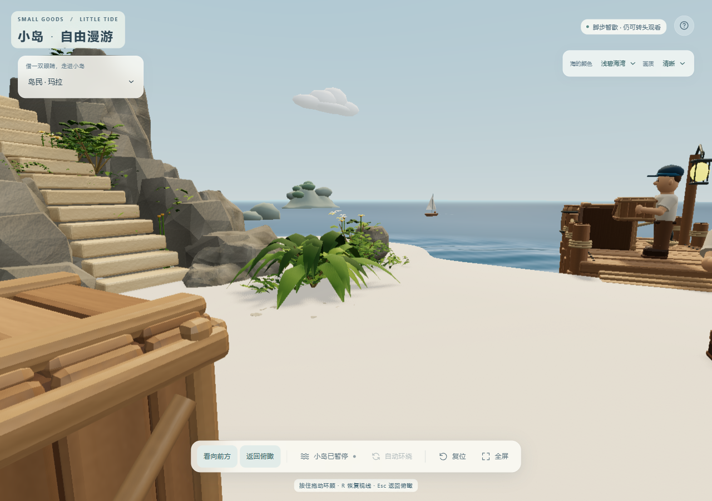
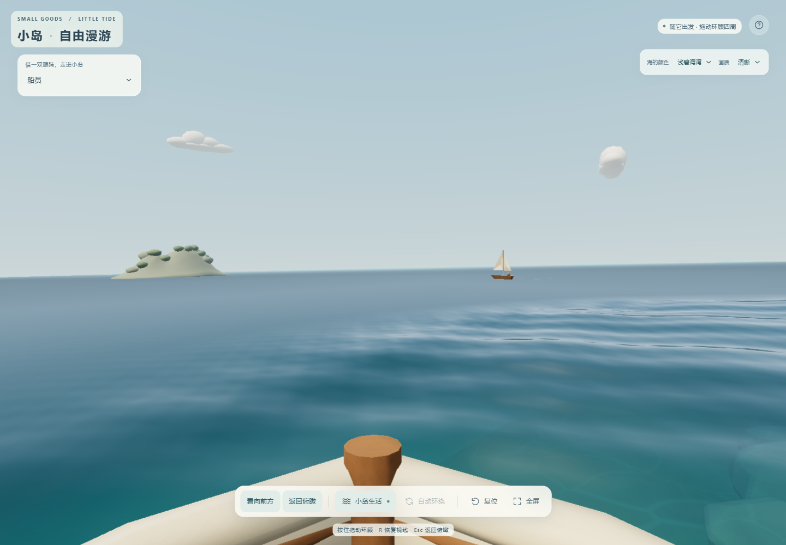
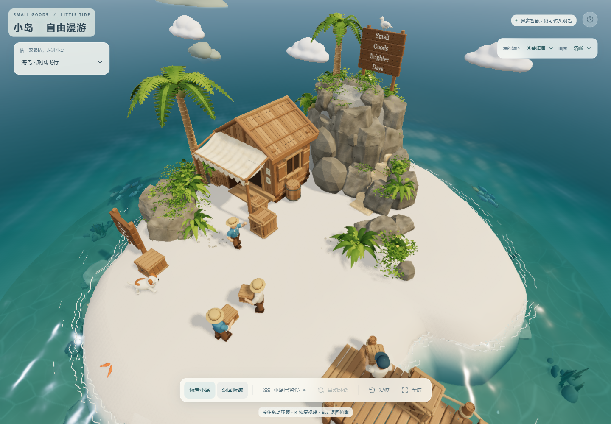
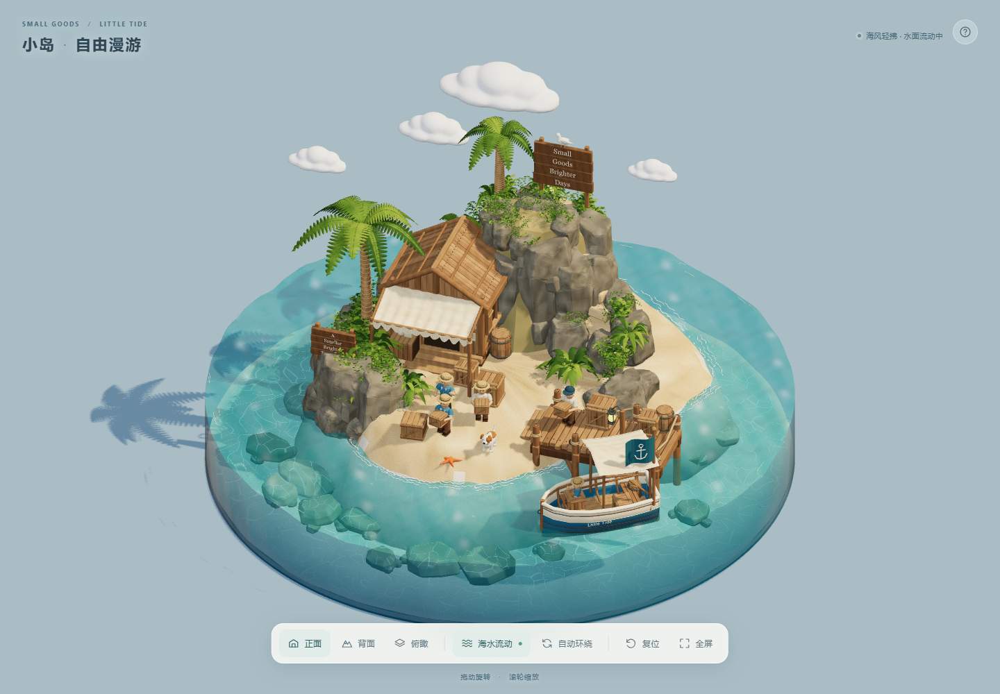
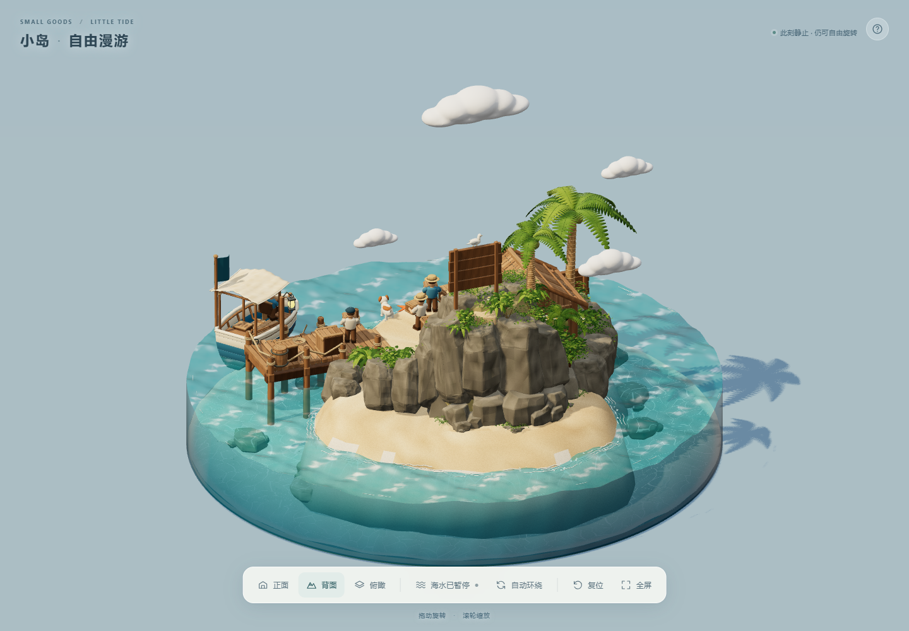
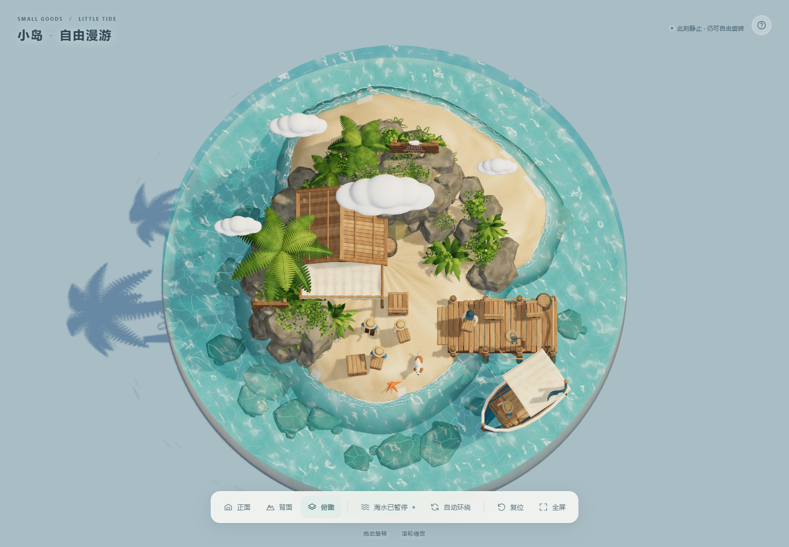
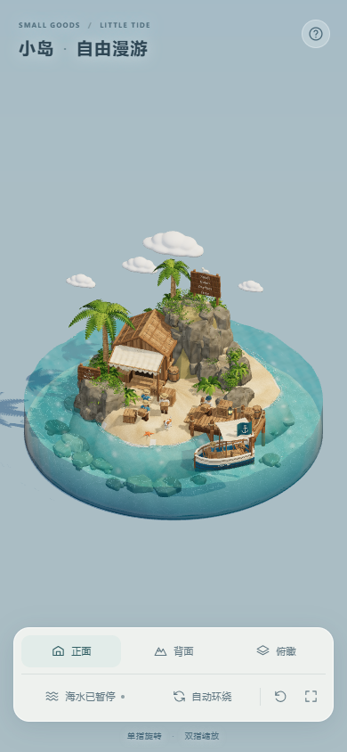

# 小岛 · 自由漫游

> **当前本地版本：V14.4 · 2026-10-30，尚未发布或推送**：右上角一个「开启声音」开关，即可听见混合好的海浪、海鸟和远处含混人声；音量较短片提升，默认静音，暂停小岛时声音也会淡出。保留玛拉上山散步及山顶木牌落地修复。详见[环境声音](docs/ambient-audio-v14.4.md)。

> **V14.3.1 · 2026-10-30 本地更新**：修复山顶木牌立柱悬空，将木牌和停鸟整体移到台阶内侧的岩面，同步网页模型与 Blender 归档。空手的玛拉会沿石阶上山，在顶部停留 12 秒，再走回沙滩。选择「玛拉 · 山顶散步」可跟随第一视角，随时环顾或暂停。详见[山顶散步与验证](docs/mountain-walk-v14.3.md)。

> **V14.2 · 2026-10-29 本地更新**：修复近景悬空植被、屋顶文字、船桶与座板穿插；清开上山楼梯，把挡路石头移到两旁，补齐沿台阶逐渐升高的背面岩群与石质支撑。人物、小狗和鱼的自动漫游增加完整体积避让，水下码头桩延伸至海床。详见[近景修复与验证](docs/near-scene-v14.2.md)。V14.1 的八种第一视角、群岛与远船继续保留，角色自动行动、拖动只转头。原 V13 小船闭环巡航与水体修复继续保留，本地标签为 `v13-local-2026-10-29`。在线展示、下方 `preview-*` 图片及原 `small-goods-harbor.blend.zip` 仍对应 2026-10-22 已发布版本。

一座可以自由旋转的热带小岛：木屋、码头、小船、人物、棕榈树、山坡和四朵云，配合实时海浪、水下光纹与小船轻晃。

**[打开旧版在线展示](https://small-goods-harbor-yfsong.flowymule11.chatgpt.site)** · [原 Blender 模型包](blender/small-goods-harbor.blend.zip) · [Blender 与 MCP 工作流](docs/blender-workflow.md)

本仓库是独立项目，包含可运行的网页、GLB 模型、可编辑的 Blender 场景包及使用说明。本地 Git 提交不会自动同步到 GitHub；在线展示页是单独的公开站点，无需登录。

## 当前本地画面（V14.2）

| 楼梯背面的低视角 | 岩群之间的上山台阶 |
| --- | --- |
|  |  |

[本轮修复、模型导出与测试范围](docs/near-scene-v14.2.md)

## 第一视角展示（V14.1）

真实浏览器截图，2026-10-29。左上角选择身份即可进入；下方在线链接仍是旧版。

| 船员望向远海 | 海鸟俯看小岛 |
| --- | --- |
|  |  |

[完整第一视角说明与验收](docs/pov-v14.md) · [最新 Blender 模型包](blender/small-goods-harbor-pov.blend.zip)

## 已发布版本画面（2026-10-22）

以下图片来自本仓库网页的真实浏览器截图，拍摄于 2026-10-22。它们展示当时已发布的网页效果；Blender 离线渲染的材质和光照会有所不同。



| 背面 | 俯瞰 |
| --- | --- |
|  |  |

手机尺寸预览：



## 本地运行

网站采用原生 HTML、CSS、JavaScript 和 Three.js，运行依赖已经随仓库提供，**无需安装 npm 依赖，也无需构建**。

在 Windows 上，安装 Python 3 后，可以直接双击仓库根目录的 [启动小岛网站.cmd](启动小岛网站.cmd)。它会启动仅供本机访问的服务并打开默认浏览器；再次双击会复用已运行的服务。默认使用 5207 端口，占用时会尝试 5198 或其他空闲端口。它读取当前文件夹里的 `dist/`，不会自动执行 `git pull` 或切换 Git 版本。关闭浏览器不会停止后台服务，重启电脑后需要再次双击启动。

1. 获取本仓库的完整文件。
2. 安装 Python 3，在仓库根目录运行以下命令。
3. 在浏览器打开 <http://127.0.0.1:5198/>。

Windows：

```powershell
py -m http.server 5198 --bind 127.0.0.1 --directory dist
```

macOS / Linux：

```bash
python3 -m http.server 5198 --bind 127.0.0.1 --directory dist
```

终端按 `Ctrl+C` 停止。如果端口被占用，将命令和地址中的 `5198` 改为其他空闲端口。请通过 HTTP 服务器访问，不要直接双击 `index.html`。

浏览器需要支持 **WebGL 2、ES Modules / importmap、Web Worker 和 WebAssembly**。网页不需要运行 Blender 或 MCP。默认 GLB 约 7.19 MB，首次打开还会加载本地打包的 JavaScript 和解码器；7.19 MB 并非整页总下载量。

## 操作

| 功能 | 鼠标 / 键盘 | 触屏 |
| --- | --- | --- |
| 旋转 | 左键拖动 | 单指拖动 |
| 涟漪 / 小船引航 | 点击水面 | 轻点水面 |
| 缩放 | 滚轮 | 双指开合 |
| 平移 | 右键拖动 | 双指拖动 |
| 进入第一视角 | 左上角选择观察身份 | 同左 |
| 第一视角环顾 | 按住左键拖动，只转头 | 单指滑动，只转头 |
| 返回原俯瞰 | 「返回俯瞰」或 `Esc` | 点击「返回俯瞰」 |
| 暂停 / 继续 | 「小岛生活」按钮或空格 | 点击「小岛生活」 |
| 回到初始视角 | 「复位」按钮或 `R` | 点击「复位」 |

底部还可选择正面、背面、俯瞰、自动环绕和全屏。暂停会冻结海浪、岸边泡沫、水下光纹、人物、小狗、小船、海草与鱼群，仍可操作相机；已开启的自动环绕也会继续。相机静止后暂停渲染，操作相机或切换水色时仍会刷新。按下水面即产生涟漪，松开后可引导小船；提拉底座功能已移除。

旋转、缩放、平移及水面引航仅在俯瞰模式使用。第一视角中，暂停仍可环顾；`R` 恢复前方视线（海鸟为向岛内俯看），「复位」回到沙盘正面。三艘远船、飞鸟和远处水波也随暂停停止。

## Blender 模型与 MCP

V14.2 当前可编辑工作副本位于 `blender/small-goods-harbor-pov.blend`；远景保存在独立 `POV_ENVIRONMENT` 集合。模型与网页效果的对应关系见[第一视角说明](docs/pov-v14.md)，最新模型修复见[近景说明](docs/near-scene-v14.2.md)。

[模型压缩包](blender/small-goods-harbor.blend.zip)提供 2026-10-22 已发布版本对应的可编辑场景快照；最新本地工作场景见[本地更新说明](docs/local-update-2026-10-27.md)。下载并解压后，用 Blender 打开其中的 `.blend` 文件；制作和复核环境为 Blender 5.2。具体保留内容、文件校验和隐私处理见 [模型包说明](blender/README.md)。

MCP 是建模时可选的控制方式，用于让支持 MCP 的客户端与本机 Blender 通信。**查看或编辑 `.blend` 文件本身不依赖 MCP**。连接方式、工作流程、动画预览和网页转换的区别，见 [Blender 与 MCP 工作流](docs/blender-workflow.md)。

本仓库提供网页源代码与可编辑场景快照；不包含原始对话记录、完整历史建模脚本或离线渲染视频，也不保证能从空白场景自动重建全部建模历史。

## 文件结构

```text
.
├── README.md
├── THIRD_PARTY_NOTICES.md       # 第三方依赖来源与许可
├── .openai/hosting.json        # Sites 标识和静态目录配置，不含认证凭据
├── blender/
│   ├── small-goods-harbor.blend.zip
│   └── README.md              # 模型内容、隐私处理和校验信息
├── docs/
│   ├── blender-workflow.md    # Blender / MCP 使用说明
│   ├── verification.md        # 本次运行与交互检查说明
│   └── images/                # README 使用的真实网页截图
└── dist/                      # 公开网站的静态发布目录
    ├── index.html
    ├── style.css
    ├── viewer.js              # 场景加载、相机、光照和交互
    ├── water.js               # 水面、侧壁、折射与水下光纹
    ├── water-physics.js       # 有边界的水面高度场
    ├── harbor-renderer.js     # 场景颜色 / 深度采集与水体合成
    ├── harbor-motion.js       # 船、居民和小狗的实时动画
    ├── harbor-pov.js          # 第一视角相机与只转头的输入
    ├── harbor-bird.js         # 自主飞行的海鸟
    ├── harbor-world.js        # POV 天空、远岛、航船与延伸海床
    ├── harbor-navigation.js   # 小船闭环巡航、点击路径与整船安全检查
    ├── harbor-land-navigation.js # 沙地导航网格与静态障碍避让
    ├── harbor-underwater.js   # 实例化碎石、海草与游动鱼群
    ├── harbor-fish-navigation.js # 三条整岛巡游路线与鱼群水域检查
    ├── harbor-seabed-edge.js  # 加载时克隆并内收海床 / 底座上缘
    ├── public/assets/         # GLB 与模型元数据
    └── vendor/                # Three.js、Draco 和许可证
```

网页可编辑源码直接位于 `dist/`，不是由本仓库中隐藏的 `src/` 构建出来的。部署到其他静态托管服务时，发布 `dist/` 的内容，并保留 `public/assets/` 和 `vendor/` 的相对目录结构。

## 模型与动画实现

| 资源 | 大小（十进制） | 三角面数 | 用途 |
| --- | ---: | ---: | --- |
| `harbor-lite.glb` | 7.19 MB | 602,242 | 默认网页模型 |
| `harbor.glb` | 11.47 MB | 1,143,129 | 高细节备用资源 |

界面提供清晰、精细和流畅三档画质，使用同一模型。清晰档按屏幕像素密度渲染，普通屏幕为 1 倍，高 DPR 设备最高 2 倍；精细档最高 2.5 倍。各档还受画布像素预算约束，不低于 CSS 尺寸的 1 倍，不会因一次慢帧永久降画质。当前加载逻辑通常使用精简模型，仅在精简元数据请求返回非成功 HTTP 状态时尝试备用资源；它不是覆盖所有下载或解码错误的自动回退机制。

两个主岛 GLB 都使用 Draco 压缩，解码器已本地打包。模型颜色主要保存在顶点色中。29 种材质使用内嵌微法线与粗糙度纹理，涵盖木材、砂、岩石、土层和织物；共 10 张 PNG，均在 GLB 内，无需外部图片。GLB 本身没有动画片段；海浪、岸边泡沫、水下光纹和小船运动由 `water.js` / `viewer.js` 实时实现。背景微浪保留六秒周期；交互波浪由 water-physics.js 实时模拟传播、反射与阻尼。harbor-motion.js / harbor-navigation.js 驱动小船导航、浮动、人物与小狗行走，整体不再固定六秒循环。阴影最多每秒更新 10 次，默认阴影贴图仍为 1536；水下光纹由预计算纹理驱动，减少每帧着色负担。

网页顶面采用相对平静水面的波纹微折射，偏移最多 2.25 个实际画布像素，并拒绝线性深度跳变达到 0.12 的候选点、在深度梯度处渐弱；最终颜色、深度和吸收光程使用同一有效采样。侧面采样原位置景物、按统一光学厚度 1.50 计算吸收的切面透光，移除纵向颜色与透明度渐变和额外清漆反光。侧面用保留亮度的 60% 共享水色混合减少偏绿边圈，顶面外缘 0.70 场景单位渐变衔接到同一切面效果；这属于展示近似，避免再作为一层玻璃强折射，不是完整物理体积追踪。干地保护、内圈岸线遮罩与折射候选点的水域检查继续保留，外圈水壁保持完整。水下石头和木桩会随水面法线产生可见偏移；柔和天空反射与较低对比的水下光纹共同表现透明度。屏幕空间方法无法还原画面外或被遮挡的物体，也不是 Blender Cycles 的完整光线追踪。水的运动仍是有边界的二维高度场近似，不是完整三维流体。

水下新增 9 处小型群落，共 114 块碎石、63 株海草和 3 群 / 24 条鱼，以 6 个实例化网格绘制。砂床与切缘统一为灰米色。当前水体半径为 9.0、深度为 1.80，与底座基本齐平；网页加载时克隆 5 个海床 / 地层网格，将上缘最大半径从约 9.0305 内收到 8.925，水底交接截面没有突出水壁，下部地层保持原样。三群鱼分别沿长度约 45.05、46.74、48.39 的整岛路线巡游，速度为 0.50、0.555、0.61 场景单位/秒，并交错顺逆方向；实际模型 180 秒检查未发现鱼身、水域或海床违规采样。小船沿半径 7.8、长度约 49.01 的闭环连续巡航，96 个路点按固定方向衔接，实际速度约 0.765 场景单位/秒，约 64 秒一圈（首次出港另计）；整船姿态安全检查继续保留。三名陆地居民与小狗在实际沙地生成的导航网格上选择较远目标、停步并绕开静态障碍；码头工人仍在码头活动。

V11 点击水面使用强度 2.2、足迹 0.60 的不对称椭圆凹陷，再由高度场产生回弹与传播，单击峰值约 0.194，约为旧值 0.063 的三倍；背景微浪保持不变。已删除小船点击目标的 Torus 圆环，点击引航仍保留。30 秒连续输入检查没有非有限数，平均水位漂移保持在数值误差范围内。

这些材质、水下细节、光学与漫游改动均由网页运行时代码提供，V7–V13 没有改写 Blender 文件或已导出的 GLB；Blender ZIP 仍为旧归档。

## 访问与隐私

- 本地 Git 仓库包含源码与 Blender 包。2026-10-29 查询到 GitHub 远端仓库为公开状态；本地 V13 / V14.1 均未推送到远端。
- 在线展示页是公开的，浏览器必须下载网页代码与 GLB 才能显示 3D 场景，因此这些网页运行资源可被访问者获取。
- Blender 包和 MCP 文档放在 `dist/` 之外，不会随当前静态发布配置上传到公开网站。
- 不应把登录令牌、个人配置、真实账号密码或本机目录写进项目文档或模型属性。MCP 只用于本机连接，连接范围和凭据处理见工作流文档。

## 验证与依赖许可

V13 小船在 Node 240 秒模拟中绕行约 3.735 圈，受阻和不安全采样均为 0；实际 GLB 浏览器按固定步长加速推进 135 秒模拟时间，结合水面、浮力与尾迹完成两整圈，受阻、不安全采样和页面错误均为 0。135 秒是模拟时间，不是等待同等时长的实时播放。另经 5 组各 180 秒点击模拟，4 个有效目标到达并短暂停留后恢复巡航，越界目标被拒绝；全部受阻 / 不安全采样为 0。实际 GLB 浏览器也通过 180 秒模拟的点击到达 / 恢复巡航检查。

V12 已完成诊断斜角、左 / 右 / 后低角度、正面、背面、俯瞰截图检查；诊断与左 / 右 / 后低角度的视觉复核中未再见鱼和海草分离的双轮廓。交互、海床上缘、人物 / 小狗 / 船 / 鱼群运动及三种水色回归通过；390 × 844、DPR 2 的手机模拟画布为 779 × 1687，无横向溢出，未记录页面脚本或着色器错误。手机模拟不代表实体手机 GPU 验证。

同一台 Intel UHD 电脑、Chrome、1440 × 1000 视口、默认清晰档的 V12 当时三轮短测均值为 29.41 / 27.18 / 28.19 ms，约 34–37 FPS；实际画布仍为 1441 × 1001、DPR 1，阴影贴图 1536、更新 10 Hz。此前 V11 的三轮约 16.664 ms / 60 FPS 是历史测量，不能代替后续版本的实测；同一会话交替对照中，旧着色器两轮为 30.67 / 28.71 ms，新着色器为 26.89 / 26.61 ms；本轮负载下新着色器略快，仍只采集一次场景。这些均为本机短测，不承诺全设备帧率。

2026-10-27–28 本地迭代的检查范围见[本地更新说明](docs/local-update-2026-10-27.md)。以下旧验证文档保留原验证日期。

已从 GitHub 克隆副本运行静态服务器，检查模型加载、动画、暂停、旋转、缩放、相机预设和手机尺寸布局；详情见 [验证说明](docs/verification.md)。这不代表已覆盖所有手机硬件或浏览器。

Three.js 和 Draco 的完整许可证随源码提供，来源见 [THIRD_PARTY_NOTICES.md](THIRD_PARTY_NOTICES.md)。这些第三方许可不自动授予本项目场景和原创应用代码额外的开源使用权。
