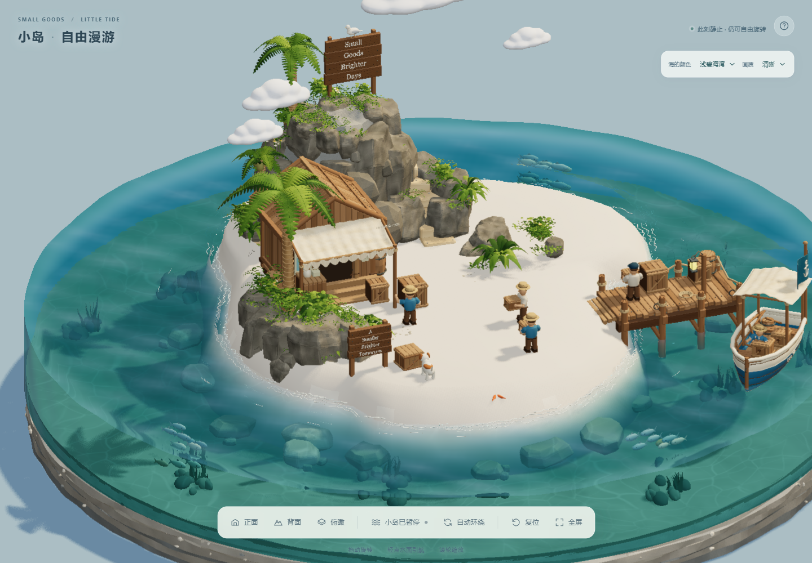
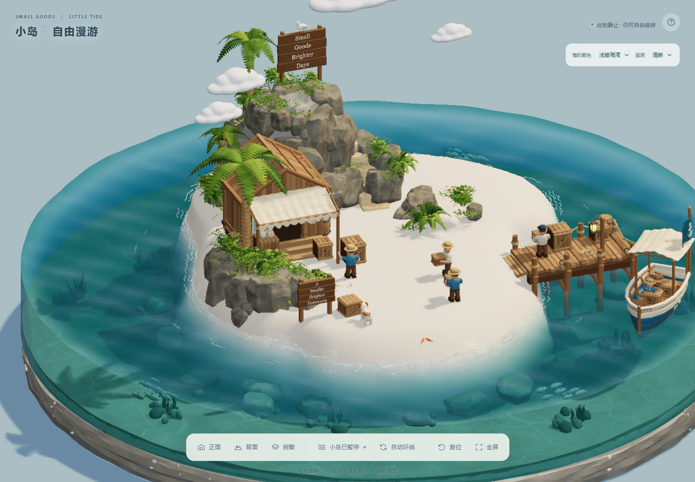
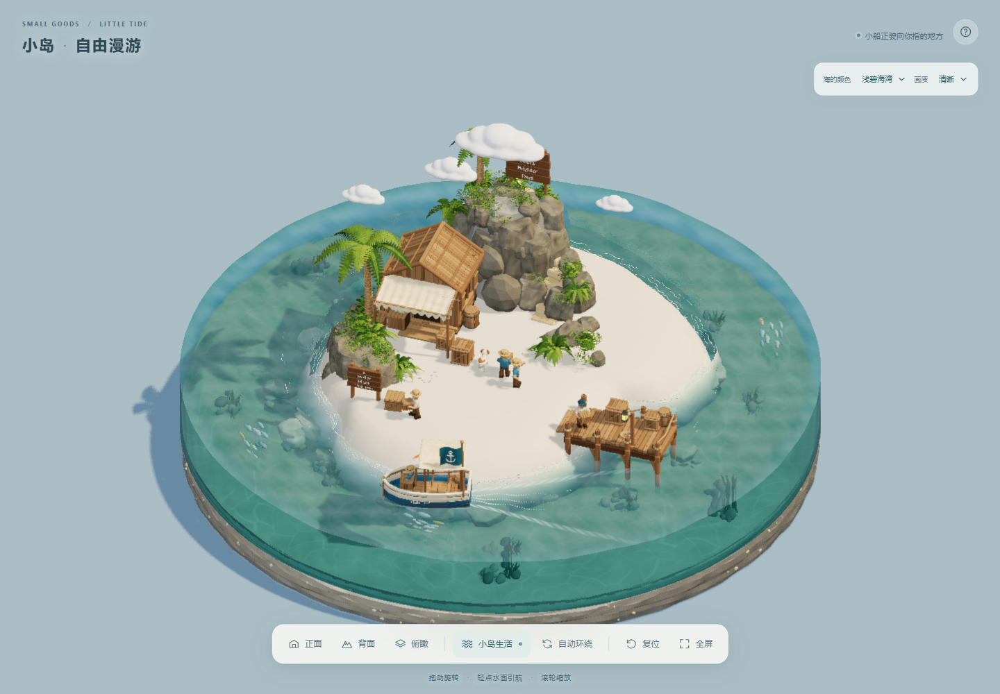
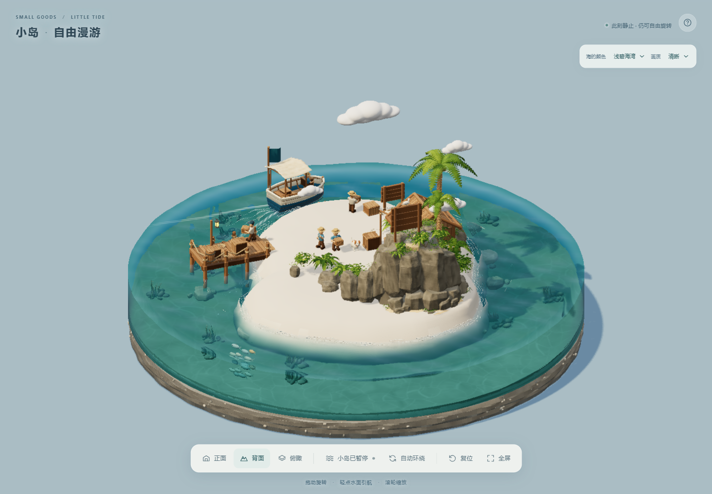
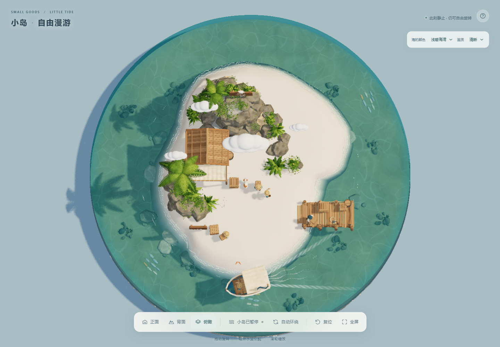
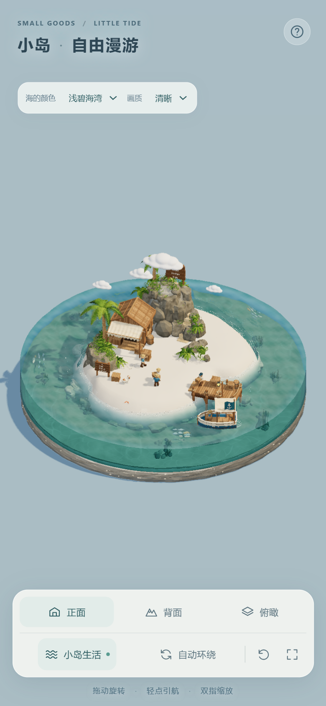
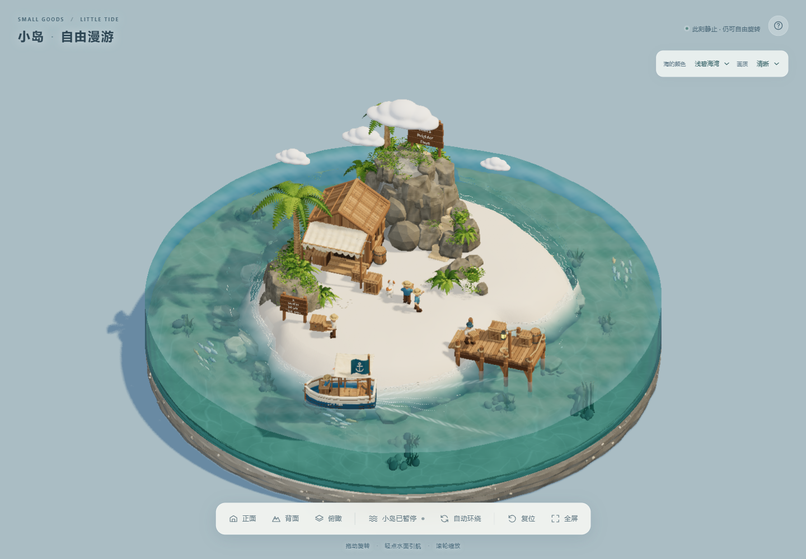
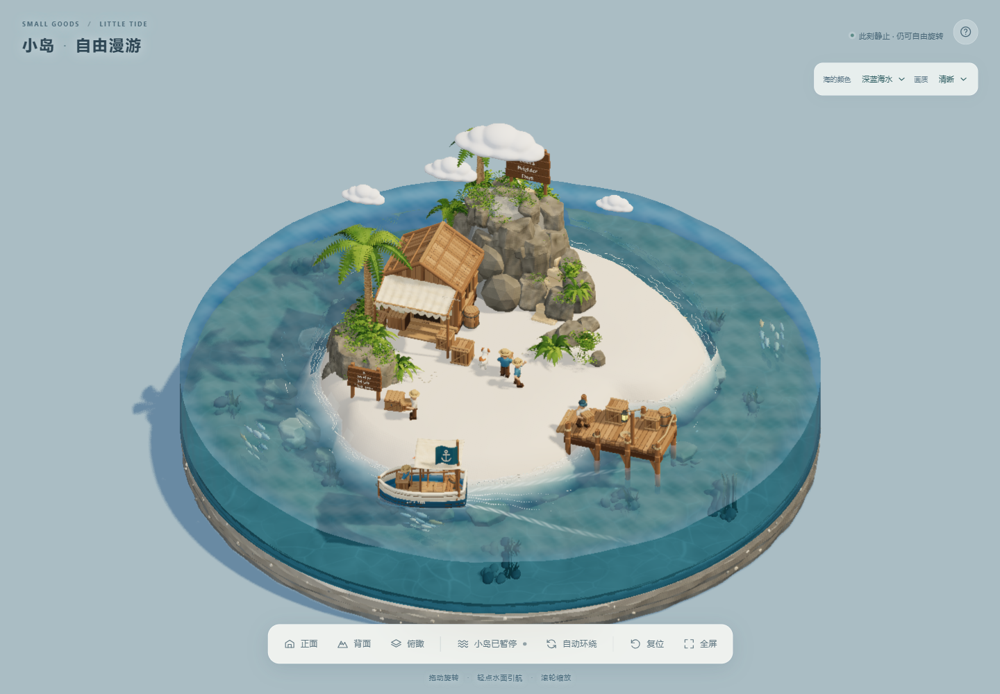
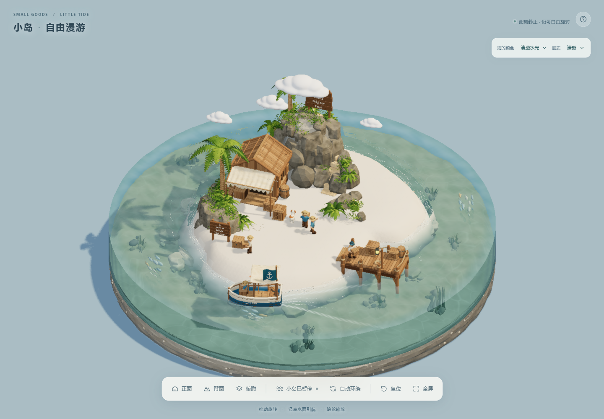

# 2026-10-27–28 本地场景迭代 · V13

**当前本地版本为 V13，更新于 2026-10-28，尚未发布。** 小船已改为沿固定闭环连续绕岛，约 64 秒一圈，首次出港另计；数值和实际 GLB 浏览器模拟均完成多圈安全检查。V12 斜角微折射、V11 点击水波与海床上缘内收继续沿用。下方 V12 / V11 的画面与性能记录保留对应版本标记。本次没有发布 Sites、推送 GitHub 或合并主项目。

## 2026-10-28 · V13 小船连续绕岛

此前船心外缘余量 1.37、码头障碍余量 1.36 把码头外侧通道排除在可航区之外，逐目标 A* 路径因此转向岸侧，出现掉头。V13 在小船调用处明确采用外缘余量 0.95、障碍余量 0.90，同时保留船首、船尾及整船姿态安全检查。

初始化时对半径 7.8 的完整路线检查 720 个角度，并覆盖航向 ±0.40 弧度的转向余量；通过后沿 96 个有序路点、固定方向 -1 连续循环。路线长约 49.01，实际巡航速度约 0.765 场景单位/秒，一圈约 64 秒，首次从码头驶入路线另需时间。用户点击引航按同一绕岛方向规划弧线路径，到达后停留约 1.8 秒再恢复自动巡航；独立点击回归已通过。

- `boat-circuit-v13-validation.json`：Node 推进 240 秒模拟时间，绕行约 3.735 圈，受阻和不安全采样均为 0。
- `boat-circuit-browser-v13.log`：使用实际 GLB、水面、浮力和尾迹，以 1/60 秒固定步长加速推进 135 秒模拟时间，完成两整圈；受阻、不安全采样、水场非有限数和页面错误均为 0。这里的 135 秒是模拟时间，不是 135 秒墙钟时间的连续录屏。
- `boat-click-resume-v13-audit.json`：5 组各 180 秒模拟，4 个有效目标均到达、短暂停留后恢复巡航并继续绕岛；包括曾出现卡住的 `[7.6, 0]`。越界目标 `[20, 0]` 被拒绝，原巡航继续；全部受阻 / 不安全采样为 0，单步最大位移小于 0.0128。
- `boat-detour-browser-v13.log`：实际 GLB、水面、尾迹和角色共同运行，模拟时钟 20 秒时点击 `[7.6, 0]`，路径规划约 10.2 ms；到达后恢复巡航，总计推进 180 秒模拟时间，无页面错误、受阻或不安全采样。检查后已恢复普通 V13.1 页面。
- `v13-boat-lap-1.png` 至 `v13-boat-lap-5.png`：记录前 75 秒模拟时间的 5 个俯视位置；`v13-front.png` 为本轮正面检查。证据位于本地 `output/playwright/`。

本轮只改网页的小船运动、导航与缓存版本；水体光学沿用 V12，未改 GLB、Blender 或旧 ZIP。

## 2026-10-28 · V12 斜角折射修复（V13 沿用）

旧顶面屏幕空间折射的偏移上限为 0.032 UV，在 1441 像素宽画布上可把细小物体轮廓移动约 46 像素。单次场景采集不能提供被物体遮挡的背景；较大偏移跨过鱼、海草等物体轮廓时，逐像素深度检查与遮挡回退形成不连续采样，颜色和吸收明暗共同呈现双轮廓。

V12 只保留波纹相对于平静水面的微折射，偏移限制为最多 2.25 个实际画布像素；对深度梯度渐弱，拒绝线性深度跳变达到 0.12 的候选点。接受或回退后，颜色、深度和吸收光程始终取同一最终采样。仍复用原先的一次场景颜色 / 深度采集，没有额外绘制一遍场景。

诊断中的“只关闭颜色偏移”实验仍用了偏移后的深度，因此该实验会留下吸收明暗的残影；这不等于原版代码把颜色和深度采在不同 UV。当前修正处理的是大偏移与遮挡边界不连续，并保持最终采样一致。

| 修复前 · 同一诊断斜角 | V12 修复后 |
| --- | --- |
|  |  |

两张对照来自本地真实网页；诊断与左 / 右 / 后低角度的视觉复核中未再见鱼和海草分离的双轮廓。`ghost-verify-v12.log` 记录诊断、左低角度、右低角度、后低角度、正面、背面、俯瞰共 7 组截图，错误列表为空；最终零长度光程保护加入后，`final-shader-v12.log` 再次确认着色器编译通过、错误列表为空。

`verify-v12-final.log` 的点击波形、海床上缘零突出、人物 / 小狗 / 小船 / 鱼群运动与三种水色回归通过；手机模拟画布为 779 × 1687、DPR 2，无横向溢出，未记录页面脚本或着色器错误。`v12-dry-pixels.json` 在固定相机只改变水面时间时，经视觉核实的沙地、屋顶、山体岩石和船上部外壳抽样区域变化均为 0；船篷区域有 2 个边缘像素变化、最大通道差 4。这支持所列抽样区域稳定，不等于全画面所有像素均不变。

`perf-v12-final.log` 的三轮均值为 29.4141 / 27.1799 / 28.1852 ms，P95 为 49.9 / 33.5 / 33.6 ms，约 34–37 FPS。测试仍为本机 Intel UHD、Chrome、1440 × 1000 视口、默认清晰档、1441 × 1001 画布、DPR 1、阴影贴图 1536 / 10 Hz。同一会话的交替旧 / 新着色器对照已完成，见下表。它显示本轮负载下新着色器略快，不能将历史 V11 约 60 FPS 与当前结果的差异全归因于这次光学修正；这些 V12 短测也不承诺全设备或长期稳定帧率。

| `perf-ab-v12.json` 同一会话交替对照 | 第 1 次 | 第 2 次 |
| --- | ---: | ---: |
| 旧着色器平均帧间隔 | 30.6681 ms | 28.7101 ms |
| 新着色器平均帧间隔 | 26.8866 ms | 26.6076 ms |
| 旧着色器约合帧率 | 32.6 FPS | 34.8 FPS |
| 新着色器约合帧率 | 37.2 FPS | 37.6 FPS |

修正继续使用一次场景颜色 / 深度采集，没有新增场景绘制遍数。

## 场景总览 · 保留 V11 截图

以下正面、背面、俯瞰和手机尺寸图仍为 2026-10-27 的 V11 截图，V12 折射效果以本页上方的新对照为准。

| 背面 | 俯瞰 |
| --- | --- |
|  |  |

## 当前场景与操作

- 干地轮廓约 66.71 个场景平面单位，比原先约 30.50 增加约 118.7%。房屋与山体沿后侧围合空地；房屋、人物与狗的尺度不变，左侧小牌子露出。
- 山体露出的黄色内芯改为灰岩并补岩块；中央沙地为象牙白细沙，海床与切缘为灰米色。下方保留厚约 1.05 的地层底座、10 段不规则层界和 110 个嵌入式矿物细节。
- 29 种材质带内嵌微法线、粗糙度贴图，涵盖木材、岩石、沙粒、土层与织物；GLB 共含 10 张 PNG，无需远程纹理。
- 三名陆地居民与小狗在实际沙地和静态障碍生成的导航网格上选择较远目标，穿行后停步张望或嗅闻；码头工人仍在码头活动。五个角色共有 22 个可动枢轴。
- 小船沿安全闭环连续绕岛，保留岸线、码头和整船姿态检查，巡航目标速度为 0.768、实际约 0.765 场景单位/秒；尾迹包含 V 形双翼、散开泡沫及水波反馈。
- 海底有 9 处碎石与海草群落，共 114 块碎石、63 株海草、3 群共 24 条鱼，以 6 个实例化网格绘制。鱼群摆尾、海草缓慢摇摆。
- 水色可选浅碧海湾、深蓝海水、清透水光。清晰档 DPR 最高 2 倍、画布预算约 240 万像素；精细档最高 2.5 倍、约 420 万像素；流畅档最高 1.25 倍、约 160 万像素。各档均不低于 CSS 尺寸的 1 倍，超大视口可能超过预算。

运行方式见主 README；本轮本地预览使用端口 5207。

- 拖动场景旋转；滚轮 / 双指缩放；右键 / 双指拖动平移。
- 按下水面立即起波；在宽阔水域轻点并松开可引导小船。V11 已移除引航目标的 Torus 圆环，保留引航功能。
- 「小岛生活」或空格暂停 / 继续水、人物、狗、船、海草与鱼群；相机稳定后暂停实际渲染。
- 「复位」或 R 回到初始视角；右上角可切换水色和画质，手机尺寸下选项位于标题下方。
- 提拉底座功能已移除，求解器的倾斜接口仅保留作内部测试。

## 水面、切面与海床交接

水体半径为 9.0，侧壁底部为局部 y = -1.80。顶面使用带像素上限、深度连续性检查的波纹微折射和水中路径吸收；干地深度 / 高度保护、内圈岸线遮罩与候选采样湿区检查继续保留。

侧面读取原位置场景颜色，采用统一光学厚度 1.50 的 Beer–Lambert 形式吸收，并以保留亮度的 60% 共享水色混合减少偏绿边圈；纵向颜色 / 透明度渐变与侧面清漆反光已移除。顶面外缘 0.70 场景单位渐变衔接到同一切面效果。**这是展示切面的透光近似，不是完整物理体积追踪。** 顶面仍有折射波纹；屏幕空间方法无法恢复画面外或被遮挡的物体，本轮诊断斜角的重影修复见上方 V12 记录。

新增 `harbor-seabed-edge.js`，只在网页启动时克隆 5 个海床 / 地层网格并内收上缘，共调整 11,414 个顶点。上缘最大半径由约 9.0305 变为 8.925；水底交接截面最大半径约 8.9260，小于水体半径 9.0，突出水壁的检查结果为 0。y ≤ -2.0 的下部地层与非目标网格均未改变，过渡在 y = -1.88 以上完全内收。这项运行时修正没有改写 GLB、Blender 工作文件或旧 ZIP。

## V11 点击水波

网页按下水面的 `poke` 参数为强度 2.2、足迹 0.60；拖动水面采样为 0.24 / 0.34。初始扰动采用保持平均水量的不对称椭圆向下凹陷，再由高度场求解回弹与向外传播。删除了小船点击目标的 Torus 圆环，背景微浪幅度没有改变。

独立数值检查中，单击立即峰值为 0.1879，随后峰值为 0.1938；旧点击立即峰值为 0.0631，新响应约为原来的三倍。中心先下凹至约 -0.1867，再回弹至约 0.0581；3 秒时能量由约 1.4803 降至 0.1067。浏览器实际点击也测到约 0.1885 的首帧采样峰值，之后传播、衰减，目标圆环保持关闭。

30 秒近岸连续输入检查包含 151 次点击和 180 次旋转扰动：非有限数为 0，峰值受 ±0.35 限制，最大平均高度漂移约 4.78e-9。体积均值校正在数值精度内有效；纯求解更新平均约 0.667 ms，不包含浏览器绘制成本。

## 整岛鱼群与渲染优化

三群鱼沿长度约 45.05 / 46.74 / 48.39 的路线绕岛巡游，速度为 0.50 / 0.555 / 0.61 场景单位/秒，顺逆方向交错。使用实际 GLB 海床进行的 180 秒检查中，鱼身、水域和海床违规采样均为 0，活动跨度约 14–15.5，最小海床间隙约 0.2635，单步最大位移约 0.01194，未出现瞬移。24 条鱼和 6 个布景实例化网格保持不变；初始化约 207 ms，纯更新平均约 0.01052 ms/次，不包含 GPU 绘制。

主画布关闭重复 MSAA，合成阶段的边缘抗锯齿继续保留，不降低 DPR；默认阴影贴图仍为 1536，更新频率从 20 Hz 调整为 10 Hz。人物、小狗、小船和模型细节没有减少。

## 历史 V11 性能与检查范围

在同一台 Intel UHD 电脑、Chrome、1440 × 1000 视口、默认清晰档下，实际画布为 1441 × 1001、DPR 为 1：

| V11 整页短测 | 第 1 轮 | 第 2 轮 | 第 3 轮 |
| --- | ---: | ---: | ---: |
| 平均帧间隔 | 16.6644 ms | 16.6638 ms | 16.6638 ms |
| 中位数 | 16.7 ms | 16.7 ms | 16.7 ms |
| P95 | 16.9 ms | 16.8 ms | 16.9 ms |
| 约合帧率 | 60 FPS | 60 FPS | 60 FPS |

每轮先经过约 45 帧预热，再记录约 149 个帧间隔。这是 V11 当时在本机、该视角的短时测量，不是全设备或长期稳定 60 FPS 的承诺。

- `verify-v11-final.log`：正面、背面、俯瞰和三种水色截图已复核；人物、小狗、小船、鱼群持续运动；干地保护与切面光厚 1.50 生效。390 × 844、DPR 2 的手机模拟画布为 779 × 1687，无横向溢出，未记录页面脚本或着色器错误。手机检查来自桌面浏览器模拟，不能代表实体手机 GPU 性能。
- `verify-v11-click.log`：实际点击起波、无目标圆环、海床内收启用；采样无非有限数。日志记录 0 个错误、2 个控制台警告，不能据此声称无警告。
- `perf-v11-final.log`：以上三轮整页短测及 DPR、阴影配置。
- `click-wave-v11-validation.json`：单击下凹 / 回弹 / 传播与 30 秒连续输入检查。
- `seabed-edge-v10-validation.json`：5 网格上缘内收、水底截面和下部不变检查；文件沿用 V10 命名，V11 浏览器复核确认该修正仍启用。
- `fish-cruise-v10-validation.json`：180 秒实际海床鱼群检查；V11 浏览器复核确认三路线继续运行、违规采样为 0。

以上证据文件位于本地 `output/playwright/`。它们记录 V11 当时的检查；斜角重影由本页 V12 记录补充，不追溯改写旧日志。

## 水物理的准确范围

当前采用有边界的自由表面高度场近似，使用 145 × 145 网格、固定 1/120 秒步长，计算波传播、圆形外壁与岸边反射、阻尼和体积均值校正。每帧最多补算 0.25 秒，页面隐藏时暂停。水面、法线、侧壁上缘与小船浮力采样共享同一场；程序化微浪和焦散为视觉补充。

**这不是完整三维粒子流体。** 当前不模拟溢水、翻卷碎浪、干湿岸线迁移或飞散液滴。Three.js 官方水面示例、Evan Wallace WebGL Water 和 Splash MLS-MPM 的研究及许可说明见[水体研究](water-research.md)，完整粒子方案尚未接入。

## 历史参数与检查

以下只保留版本演进和既有证据，不作为当前 V13 的帧率依据：

| 历史版本 | 当时状态 / 本机短测 |
| --- | --- |
| V6 | 普通屏取消强制 1.5 倍超采样，缓存阴影，焦散改为纹理采样；平均 17.41 ms，约 57 FPS。 |
| V7 | 引入场景折射、吸收和天空反射；背景波幅总和由 0.098 降为 0.045，点击强度由 1.4 降为 1.0，旋转扰动系数由 7 / 4 降为 2.8 / 1.6；仅折射版本平均 16.66 ms。 |
| V8 | 加入海底布景；三轮均值 19.68 / 19.80 / 19.13 ms，约 51–52 FPS。 |
| V9 | 修复导入节点名空格转下划线后的海床材质匹配，增加干地保护、陆地漫游和提速；曾临时将水半径增至 9.25，深度由 1.64 增至 1.80。三轮均值 22.70 / 23.71 / 20.02 ms，约 42–50 FPS。 |
| V10 | 水半径恢复 9.0，侧面改为统一光厚切面，鱼群改为整岛巡游。单项 A/B：基线 20.36 ms，关闭主画布 MSAA 后 18.01 ms，再改 10 Hz 阴影后 17.33 ms；基线复验 19.57 ms。该局部对比不替代 V11 整页结果。 |

V10 对侧面深带与底缘亮边的四组消融显示：关闭侧面纵向渐变几乎无变化；关闭吸收后深带消失；关闭折射偏移改善水草错位但深带仍在；让侧面使用顶面法线可改善深带但出现拉伸。证据指向折射采样与光程估计不连续，形成了当前展示切面的实现依据；它不证明所有斜角重影均已解决。

V9 使用实际 Draco GLB 的 120 秒 / 7200 帧检查中，三名陆地居民与小狗无越界，blockedMoves 均为 0；1200 次真实网格射线抽样未发现碰撞，小船全程位于安全水域。固定相机、只改变水面时间的像素抽样确认中央沙地、屋顶、山体不变而水区变化，支持抽样干地保护生效。V7 低帧率检查中，10 FPS 与 60 FPS 输入经过 2 秒后模拟时间与网格一致；720 次强点击无非有限数。更早的倾斜测试仅为求解器历史证据，当前界面没有提拉功能。

## Blender 与归档

最新独立工作文件为 `small-goods-harbor-expanded.blend`；修改前另存了 `small-goods-harbor-before-expansion.blend`。Blender 时间轴为 24 fps、1–2880 帧，包含人物、狗和船的演示动画；网页点击水波与导航实时计算。

`blender/small-goods-harbor.blend.zip` 仍是 2026-10-22 的归档，未替换、未上传。在线网站和 README 中的 `preview-*` 截图也仍对应该已发布版本。本次新工作文件未打包到公开网站。

V7–V13 的水体光学、海底布景、材质覆盖、自由漫游、整岛鱼群、渲染优化、点击波形、海床上缘内收、微折射修正与小船闭环巡航均由网页运行时代码提供，没有改写 Blender 工作文件、导出的 GLB 或旧 ZIP；旧模型包不含这些网页专属改动。

## 历史 V11 水色对比

| 浅碧海湾 | 深蓝海水 | 清透水光 |
| --- | --- | --- |
|  |  |  |

本页正面、背面、俯瞰、手机尺寸及三种水色共 7 张总览图片保留最终 V11 实际网页截图，文件名与拍摄标记为 2026-10-27；V12 新增的两张诊断对照使用 2026-10-28 文件名。README 的 `preview-*` 旧发布截图保持 2026-10-22 标记。
