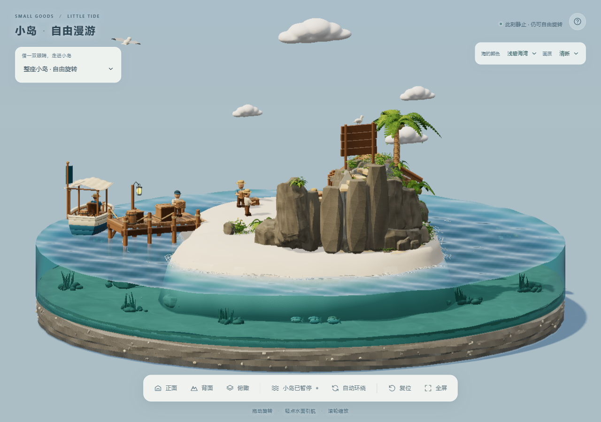
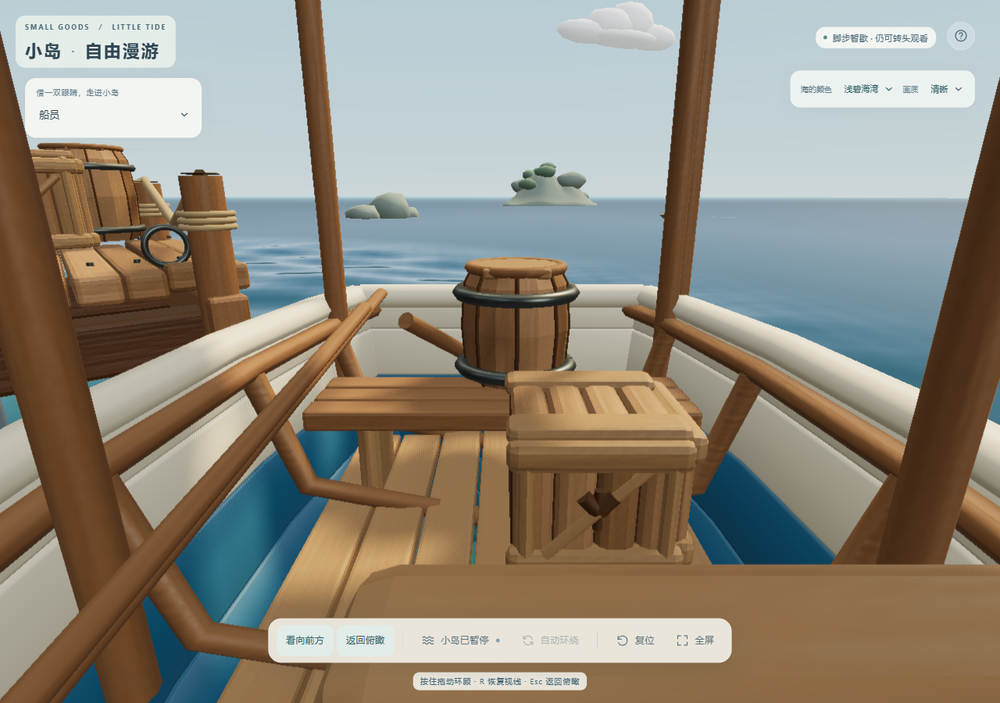
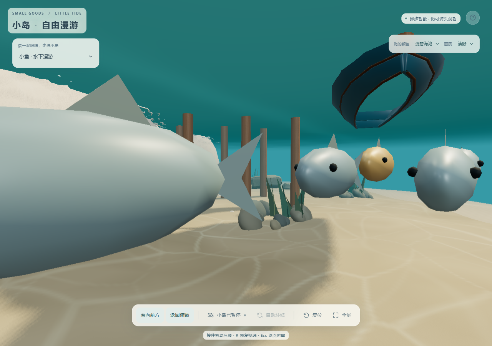

# V14.2 · 近景结构与运动修复

2026-10-29，本地更新；没有发布、推送或合并资产岛主项目。双击项目中的「启动小岛网站.cmd」运行当前工作目录中的版本。已经打开的页面刷新即可更新。

## 模型

- 将 7 块遮挡楼梯或踏步边缘的原岩石完整移到台阶旁边。上山路线整理为 19 级连续踏步；两侧增加 20 块随台阶逐渐升高、略高于踏步的灰色岩石。
- 楼梯下方使用石质承托；浅色只保留在薄踏步上，背面低角度不再看到一整排米黄色高柱。19 级各 5 个横向位置的踏面采样没有岩石覆盖，有效宽度约 0.56。
- 灌木、蕨类、大叶植物落到实际岩石或沙地；悬空地被按单片叶面保持形状并贴合地形。
- 商店名称安装到实际山墙的木牌上，地图标题回到地图面板，修复扩建后文字仍留在旧坐标的问题。
- 船内整组木桶移到横座板上，避免桶身与座板、座脚和舵柄相交。
- 8 根码头桩的水下段从约 −0.72 延长至 −1.68，埋入海床；水上段高度保持原值。

| 船内摆放 | 水下码头桩 |
| --- | --- |
|  |  |

## 自动漫游

人物和小狗根据实际几何的水平包络避让；接近另一角色时减速停步并重新找路。静态避障同时覆盖前伸货箱和转身范围。角色尺寸、自动行走和第一视角输入方式保持原设计。

24 条鱼保留原速度、外观及环岛路线；三群错开深度，并按包含尾鳍的完整鱼体调整队列间距。没有增加绘制次数、逐帧射线检测或重型物理解算。

## 验证

- 最终轻量 GLB SHA-256：`760dea059a1125864386994ec948bbeadea93da7f933bf4c39af211a16be6392`。
- 最终模型 240 秒、60 Hz：角色每帧包络检查零重叠，持续大范围漫游；实际动画顶点没有超出避让包络。全材质角色对静态几何每 0.2 秒抽样无相交。
- 靴底与实际沙面核验：至少一只脚的离地量保持很小；索尔最大约 0.000264，未确认整体漂浮。保留了摆腿时最多约 0.016 的轻微入沙。
- 最终模型 240 秒、60 Hz：完整鱼体间零重叠、岸边零越界，海床抽样零穿入。对 17,432 个水下静态三角面（含加长码头桩、海底岩石和山石）的保守包围检查零重叠。鱼第一视角与两眼中点误差约 `1.47e−7`。
- 浏览器复核背面低角度、岛民、狗、船和水下视角，无页面脚本错误。390 × 844 布局无横向溢出，拖动环顾正常；此项为桌面浏览器缩小视口，不代表手机真机性能测试。
- 不带对话上下文的独立评估 agent 逐图检查，第二轮没有发现截图范围内新的明确静态穿帮；补拍水下视角确认可见柱脚接入海床，其余被鱼和海草遮挡的柱脚由几何核验覆盖。

本轮不宣称穷尽每个物体、每一帧和所有设备。完整本地采样记录保存在忽略于 Git 的 `output/near-scene-v142/`、`output/playwright/clip-audit-2026-10-29/geometry/` 和 `output/playwright/fish-contact-fix-2026-10-29/`。

## 可编辑源与重复导出

最新工作文件为 `blender/small-goods-harbor-pov.blend`；便携归档及校验见 [模型说明](../blender/README.md)。修复脚本保存在 `blender/fix-near-scene.py`、`add-stair-back-rocks.py`、`finish-near-supports.py`，前后模型备份保存在本地 `output/`。已有修复标记的工作文件不可重复运行一次性修复脚本。

可在独立 Blender 后台进程执行 `blender/export-harbor.py -- --lite`，再以空场景执行 `blender/export-compress.py -- --lite`；去掉 `--lite` 生成完整模型。导出默认写入 `output/export-staging/`，不覆盖交互式 Blender 场景。它保留原材质、10 张内嵌微纹理、角色枢轴及顶点色，并排除独立远景集合；验证后将两种 GLB 和对应 metadata 复制到 `dist/public/assets/`。浏览器海水、鱼群和人物漫游仍由 JavaScript 实时实现。
