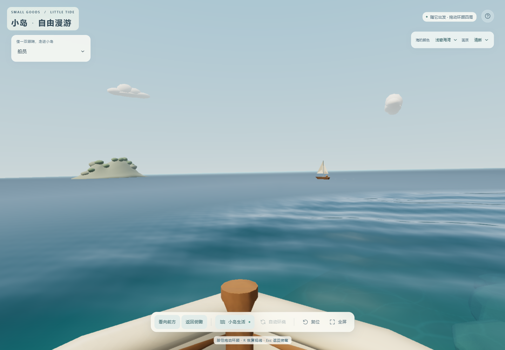
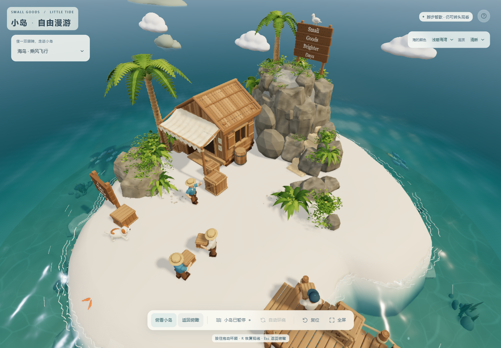
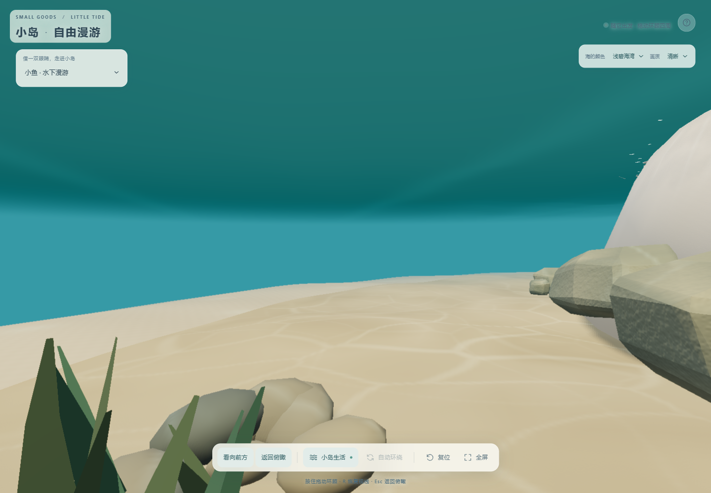

# V14.1 · 跟随岛上的生活

本页记录 V14.1 第一视角开发时的构建与验证。当前本地版本已更新至 [V14.2 近景修复](near-scene-v14.2.md)，主岛模型与便携归档的最新数量和校验以 [模型清单](../blender/pov-model-manifest.json) 为准；下文的 3,119 对象等为 V14.1 历史记录。

本地开发日期：2026-10-29。本轮没有发布到 Sites，也没有推送到 GitHub。此前 V13 保留为本地标签 `v13-local-2026-10-29`。

## 观察方式

左上角「借一双眼睛，走进小岛」提供四位居民、船员、小狗、小鱼和海鸟，共八个观察对象。角色沿原有路线自主行动；鼠标按住拖动或触屏单指滑动只改变视线，不控制角色方向、速度或目的地。

- `R` / 「看向前方」恢复角色前方；海鸟恢复向岛内俯看的视线。
- 「返回俯瞰」/ `Esc` 恢复进入前的俯瞰位置、目标、缩放和自动环绕状态。
- 暂停冻结角色和世界动画，仍可转头。操作按钮或下拉框时，空格遵循该控件的正常键盘行为。
- 第一视角不触发水面引航、点击水波、俯瞰旋转或缩放；这些操作在返回俯瞰后恢复。

相机使用稳定的身体/船体姿态与眼睛位置，隐藏被观察对象会遮挡镜头的部分；船体和甲板仍可见。自动转头保留阻尼并限制到每秒 90°，手动环顾即时响应。小鱼选取鱼群领游排的一条，避免默认视线紧贴队友。海鸟是新增的自主飞行对象，约 48 秒绕岛一周。

## 从沙盘走进海岛

俯瞰保留原来的圆形水体、底座和四朵主岛云。第一视角启用独立环境：六组远岛、四组礁石、五组远云和三艘小帆船；海面延伸到半径 100，海床逐渐下降并与水下雾融合。展示背景地板与底座切面在该模式隐藏，返回后恢复。

三艘远船沿独立椭圆航道缓慢航行，周期分别为 90、110、130 秒，带轻微浮动和尾迹。它们是远景装饰船，和主岛可跟随、可引航的小船分开。新增 GLB 为 256,712 字节、12,798 三角面、14 个网格及 6 种材质，避免为远景使用主岛级别的复杂模型。

近岸仍使用半径 9、深度 1.8 的原有二维水面高度场；远海是视觉延伸，不把流体网格放大到整个海域。水下视角增加水面背面与折射窗口。它们是实时光学近似，不是三维流体或完整光线追踪。

## 文件与 Blender

- `dist/harbor-pov.js`：独立透视相机、视线输入、暂停与俯瞰恢复。
- `dist/harbor-motion.js`、`dist/harbor-underwater.js`：只读眼睛姿态接口；原导航继续独立运行。
- `dist/harbor-bird.js`：飞行海鸟。
- `dist/harbor-world.js`：天空、延伸海床、远景模式与三艘船的动画。
- `dist/water.js`：近岸水体、可逆远海延伸与水下背面。
- `dist/harbor-renderer.js`：用当前相机完成一次实体场景颜色/深度采集，再合成水面。
- `blender/build-pov-environment.py`：在 Blender 工作副本中可重复生成 `POV_ENVIRONMENT` 并只导出该集合；不重写主岛 GLB。

项目内的 `blender/small-goods-harbor-pov.blend` 是当前可编辑工作副本，默认忽略于 Git；工作源来自 2026-10-27 的扩建版。`POV_ENVIRONMENT` 默认关闭视口与渲染显示，可以在 Outliner 启用以编辑远岛、云和帆船。网页中的天空、海床延伸、水面光学、角色跟随和远船航行由 JavaScript 实时生成，不是 Blender 时间轴动画。

Git 中保存了单独的[便携模型归档](../blender/small-goods-harbor-pov.blend.zip)，包含主岛和新环境，可在工作副本丢失时恢复。压缩包约 10.68 MB；已清理本机路径并解压重开，3,119 对象、2,342 mesh、77 材质、496 条场景依赖驱动及几何/材质/形态键/层级校验一致。[模型清单](../blender/pov-model-manifest.json)记录具体检查范围。

构建前后原有 3,102 对象、2,328 个 mesh 数据块、452,942 顶点、346,189 多边形及原对象变换、材质节点、相机的校验值一致。新增环境连续重建的 GLB 哈希一致；导出文件没有外部贴图、资源链接或所检查的个人路径。三艘船椭圆路径各采样 720 点，按保守岛礁及船体包围圆检查，最小净空为 9.03 / 4.64 / 9.85 场景单位。

## 验证范围

独立评估 agent 在没有继承本对话历史的情况下制定验收场景，用真实浏览器操作检查，再把问题交回实现端修复。第一轮发现并修正了海鸟初始视线只见背景、按钮上按空格误切播放，以及岛民自动转弯过急；第二轮重点复查新增海域和相机限速。

数值检查：

- 实际主岛 GLB 的人物/狗/船姿态读取持续模拟 120 秒，43,206 次读取保持有限、归一化，和不读取姿态的原运动结果一致。
- 全部 24 条鱼持续模拟 180 秒，361 组样本与原路线一致；隐藏选中鱼的实例不会改变群体导航。
- 自动相机 600 次可变步长/复合姿态采样未超过每秒 90°；跨 ±180° 按短弧转向；`dt=0` 冻结自动跟随，手动转头仍立即生效。
- 远海开关前后，12 秒 / 720 步模拟的 25 次完整高度场对照一致；原近岸网格未替换，连接处 256 个顶点逐值相同。

浏览器最终复测结果与代表截图见本页下方的验收记录。原始检查脚本和日志保存在本机 `output/review/`，未加入公开发布目录。手机尺寸模拟不代表实体手机 GPU 或 iOS Safari 测试；近距离观看会显露既有模型的低面数细节。

## 浏览器复测记录

第二轮修正了稀疏远海网格产生的放射状反光：半径 9–12 过渡为平缓长波，远水主反射与清漆法线逐像素计算，并抑制小于像素的微纹理，未增加远水网格或绘制批次。船员与海鸟同类视点重新截图后，原有扇纹与浪墙观感已消失。

- 岛民真实连续播放 37.8 秒、采集 2,267 个 RAF，覆盖先前发生急转的第 33 秒；自动转头最大约 90.000000001°/秒，超过 90.1°/秒的样本为零。
- 暂停时，角色眼位、模拟时间和三艘远船位置不变，实际鼠标拖动能环顾；五类身份退出后，自定义俯瞰位置及缩放逐值恢复。
- 居民、狗和船四向环顾截图中未见远水圆盘接缝；鱼前、上、下、后视图中可见连续海床和水面天空窗。三种水色分别在船与水下视角检查。

最终桌面性能：Intel UHD / Chrome 155，清晰档，CSS 视口 1440 × 1000，实际画布 1441 × 1001，DPR 1，阴影贴图 1536；每模式三轮、每轮 120 个实际 RAF 间隔，均确认浏览器在前台。

| 模式 | 三轮平均帧间隔范围 | 约 FPS | p95 |
| --- | --- | --- | --- |
| 俯瞰 | 16.665 ms | 60 | 16.8–16.9 ms |
| 居民 | 16.663–16.666 ms | 60 | 16.8–16.9 ms |
| 小狗 | 16.664–16.668 ms | 60 | 16.9 ms |
| 船员 | 16.663–16.666 ms | 60 | 16.9 ms |
| 小鱼 | 16.663–16.665 ms | 60 | 16.9 ms |
| 海鸟向内俯看 | 20.411–20.415 ms | 49 | 33.3–33.4 ms |

海鸟同时看到较完整的主岛与海域，帧耗高于其他视角；没有为此降低画布分辨率。这是当前电脑的前台短测，不是全设备帧率承诺，亦不与不同负载下的旧测量直接计算优化比例。本轮页面错误列表为空；仍有既有驱动的着色器浮点精度警告。

手机最终复查使用 390 × 844 与 844 × 390 视口：五类身份可切换，选择器与返回按钮位于可操作区域，无横向溢出。DPR 3 设备模拟下，清晰档实际使用 DPR 2，竖屏画布为 780 × 1688。真实 CDP 触摸事件改变视线后，暂停中的时间、眼位、三艘远船及水面交互计数均未改变；返回后原相机与缩放一致，远景、水下模式及隐藏状态正确复原。页面错误为空，控制台两条既有数值精度 warning 未阻止着色器编译。

独立评估最终未发现确认的阻塞项。验证不覆盖所有长期行走组合或所有极端近景；水下内反射仍为近似，低面数模型在贴近观察时可见棱角。

| 船员望向远海 | 海鸟俯看小岛 |
| --- | --- |
|  |  |

